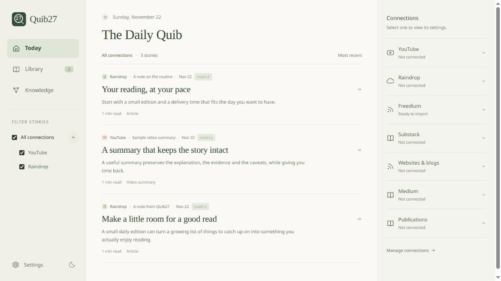
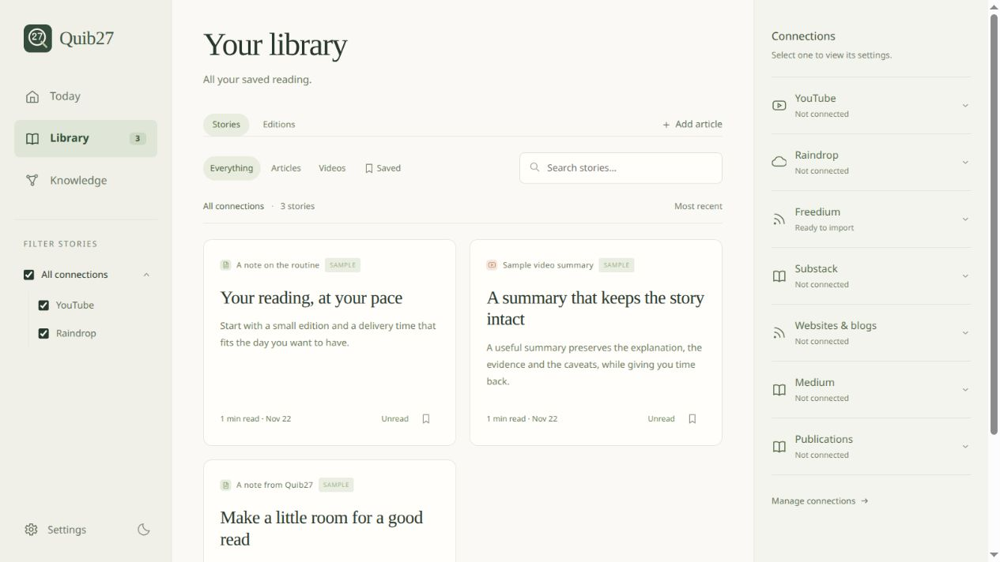
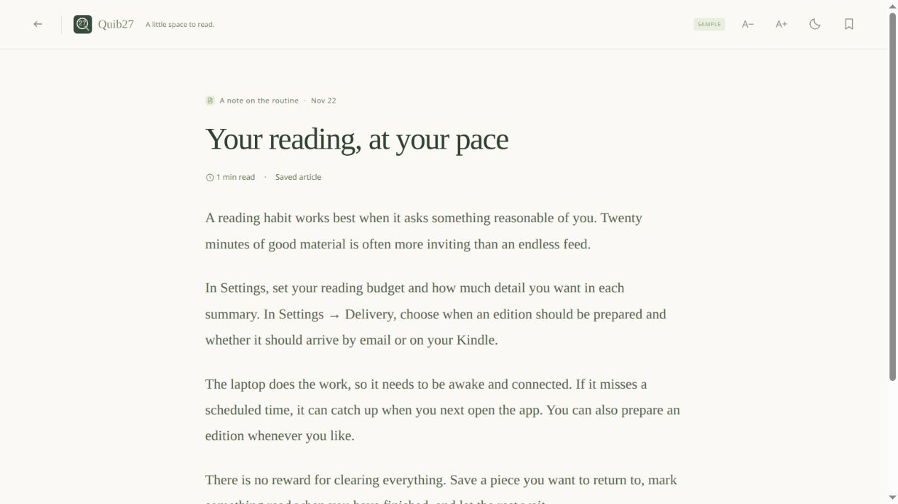

<h1 align="center">Quib27</h1>

Your reading, in one place.

Follow the sources you care about. Read without distractions. Keep an edition on your laptop, in your inbox, or on your Kindle.

  <a href="https://github.com/arbi11/kindle_service/releases/tag/v0.4.0">Download the preview</a> ·
  <a href="INSTALL.md">Installation & setup</a> ·
  <a href="https://github.com/arbi11/kindle_service/issues">Report an issue</a> ·
  <a href="connections/README.md">Contribute a connection</a>

Articles in bookmarks. Newsletters in your inbox. Videos in a watch-later queue.
Quib27 brings that reading into a library on your own computer. Follow a few
sources, fetch their latest posts, and read them in a quiet, adjustable reader.
Add your own API key when you want summaries of articles or YouTube videos.

**Free to use. No Quib27 account. No hosted reading database. Kindle optional.**

## Download

This is the first public **v0.4.0 preview**. Start with the build for your computer.

| Your computer | Download | Installation |
| --- | --- | --- |
| Ubuntu / Debian, x64 | [Linux `.deb`](https://github.com/arbi11/kindle_service/releases/download/v0.4.0/quib27-0.4.0-linux-x64.deb) | Open in your software installer |
| Other Linux desktops, x64 | [Linux archive](https://github.com/arbi11/kindle_service/releases/download/v0.4.0/quib27-0.4.0-linux-x64.tar.gz) | Extract and run Quib27 |
| Windows, x64 | [Windows setup](https://github.com/arbi11/kindle_service/releases/download/v0.4.0/quib27-0.4.0-windows-x64-setup.exe) | Run the setup wizard |
| Mac with Apple Silicon | [macOS arm64 `.dmg`](https://github.com/arbi11/kindle_service/releases/download/v0.4.0/quib27-0.4.0-macos-arm64.dmg) | Drag Quib27 into Applications |
| Mac with an Intel processor | [macOS x64 `.dmg`](https://github.com/arbi11/kindle_service/releases/download/v0.4.0/quib27-0.4.0-macos-x64.dmg) | Drag Quib27 into Applications |

**Preview limitations:** Windows builds are unsigned; macOS builds are ad-hoc
signed, without Apple notarization. Your OS may warn or block these downloads.
Native build and startup checks do not replace testing on real desktops. See
[installation details, checksums and data locations](INSTALL.md).

## What you can do

- **Read Today:** a compact Daily Quib list of your saved stories, newest first.
  It includes your history, not just articles published today.
- **Browse your Library:** cards, search, article/video filters, bookmarks,
  reading status and an unread count. Open any story directly in the full reader.
- **Choose your connections:** filter stories with checkboxes on the left;
  expand connection settings on the right.
- **Make reading editions:** prepare collections, import EPUBs, export EPUB or
  HTML, and optionally send editions by email or to Kindle through your own SMTP account.
- **Use your own AI:** choose OpenAI or OpenRouter, your model and your summary
  length. Public articles can be collected and read without a model key.
- **Read comfortably:** light and dark themes, a sepia reader and adjustable text.
- **Explore Knowledge:** an interactive graph of saved reading, filtered by
  connection and publication date. Concept browsing uses an optional local pilot;
  automatic concept extraction across your library is not implemented yet.

See the Library and full reader

Screenshots use the app's included examples. No personal library or API key is
included in a download.

## Connections

| Connection | What it collects | Setup |
| --- | --- | --- |
| **YouTube** | Summaries of new videos from followed channels | Channel URL or handle, plus your model API key |
| **Raindrop** | Articles saved in selected bookmark collections | Your Raindrop API token and collection |
| **Substack** | Public posts from chosen publications | Publication address or RSS feed |
| **Websites & blogs** | Articles from RSS and Atom feeds | Website or feed address |
| **Medium** | Posts from followed creators | Creator handles or profile links |
| **Freedium** | An article link or the public Recently Unlocked feed | No account required |
| **Publications** | Articles selected using your written preferences | Publication URL and preferences; optional local sign-in |

Publications is an experimental connection. Extraction depends on the site and
available access; a login does not guarantee a complete article. Failed or
unverified copies are reported rather than silently imported. Medium can try
Freedium when a feed supplies only a preview. These third-party services can change
or stop working.

Connections are reviewed before they join the catalogue. The feed SDK and
[contributor guide](connections/README.md) describe how to submit one through GitHub.
The application remains proprietary.

## Your first reading session

1. Install Quib27 and try the three clearly labelled sample stories.
2. Expand **Websites & blogs** or **Substack** on the right. Add a site you already
   read, then fetch its articles. Neither connection needs an AI key.
3. For summaries, open **Settings → Preferences**, select your provider and model,
   enter your API key and save. Checking the model makes a small billable request.
4. Follow YouTube channels or connect Raindrop. Read in **Today** or **Library**.
5. If you want delivery, configure **Settings → Delivery**, then prepare an edition
   in **Library → Editions**. Preview it before sending.

The app is free; your model provider bills API usage separately. You do not need
to configure email, own a Kindle, or enable a schedule to use the reader.

## Where your data goes

Your library, settings and saved reading stay in a local data directory. Quib27
has no analytics, hosted account or sync server. Credentials use the operating
system's credential store when available, with a local file fallback.

Collection contacts your chosen websites and connected services. AI summaries send
the selected article text or transcript to your chosen provider. Optional public
copy searches send article metadata to search providers. Email delivery uses your
mail provider and, for Kindle delivery, Amazon. These features are not offline
processing.

Schedules run on your computer. It must be awake, connected and running Quib27;
missed scheduled slots can catch up when it resumes. Launch at login is currently
Linux-only. There is no mobile app or automatic cross-device sync in this preview.

## Project status and feedback

Quib27 is an early desktop product, originally built from two personal Kindle
delivery services. Linux has had interactive testing; Windows and macOS start with
native installer and startup checks. Please report your operating system, the
connection involved and the error message when filing an issue. Keep API keys,
cookies, email addresses and your reading database out of public reports.

- [Install, update and keep your library](INSTALL.md)
- [Detailed desktop behavior](DESKTOP.md)
- [Knowledge graph scope and limitations](KNOWLEDGE.md)
- [Native builds and verification](BUILDING.md)
- [Original command-line Kindle services](SERVICES.md)

## License

Copyright © 2026 Arbaaz Khan. **Free to use; proprietary software.** The public
repository is not an open-source license. See [LICENSE](LICENSE). Third-party
components retain their own licenses; their notices are included in the installers.
